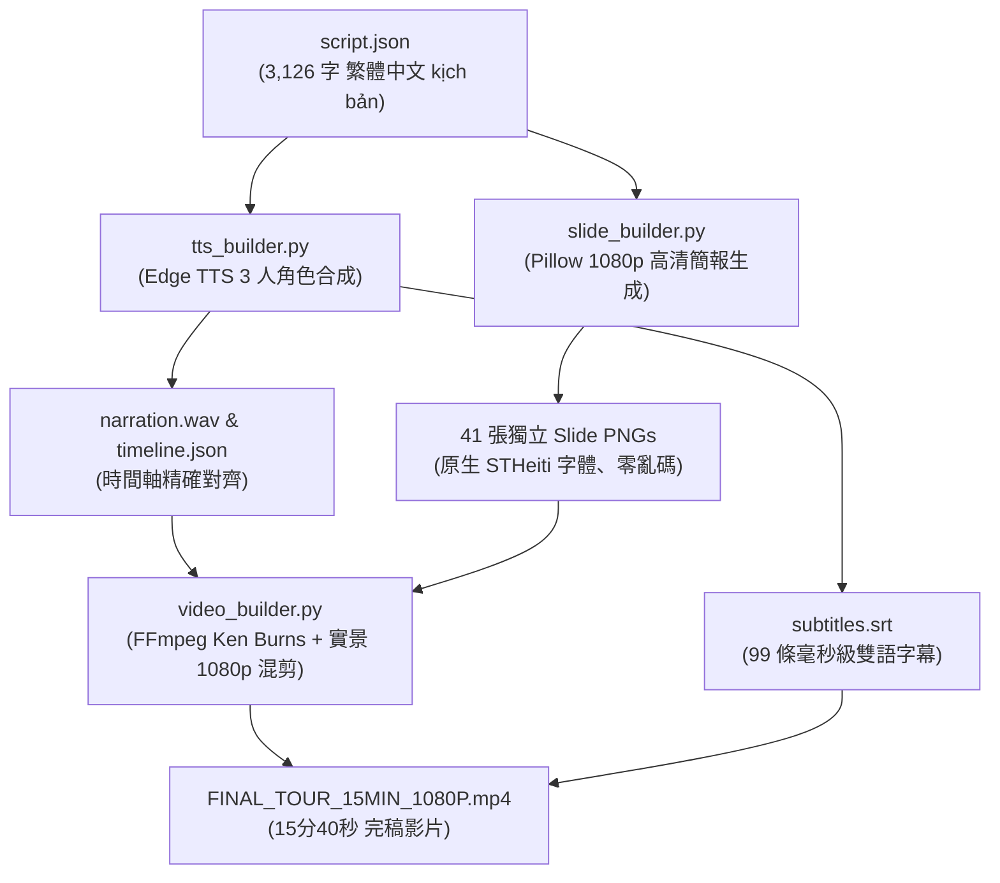

# 越青旅行社・「山海海岸・青春北台灣 兩天一夜」
### 15 分鐘完整導覽影片與自動化製作系統（1080p Full HD）

> **專案簡介**：專為 18–25 歲越南年輕首訪客量身打造的北台灣兩天一夜精選遊程。兼具「好玩、好拍、價格合理」三大核心，結合平溪天燈、九份山城、基隆夜市、野柳女王頭、淡水老街與西門町商圈。

---

## 📥 成果影片與字幕下載（Direct Downloads）

| 資源名稱 | 格式 / 規格 | 下載連結 |
| :--- | :--- | :--- |
| **完整導覽影片 (Full Video)** | 1080p Full HD (1920x1080, 30fps), 15分40秒, 836 MB | [⬇️ 點此下載 FINAL_TOUR_15MIN_1080P.mp4](https://github.com/ledat-2000/taiwan-tour-2d1n-presentation/releases/download/v1.0.0/FINAL_TOUR_15MIN_1080P.mp4) |
| **繁體中文獨立字幕 (Subtitles)** | UTF-8 SRT (99 條精確對齊語音時間軸) | [⬇️ 點此下載 FINAL_TOUR_15MIN_subtitles.srt](https://github.com/ledat-2000/taiwan-tour-2d1n-presentation/releases/download/v1.0.0/FINAL_TOUR_15MIN_subtitles.srt) |
| **GitHub Release 發行頁** | 包含完整發行說明與多媒體附件 | [🔗 前往 Release v1.0.0 頁面](https://github.com/ledat-2000/taiwan-tour-2d1n-presentation/releases/tag/v1.0.0) |

---

## 👥 三人小組角色分工與語音配置

本遊程簡報由越青旅行社三位創辦成員共同主講，語音採微軟高階台灣神經網路語音（Edge TTS）：

| 成員姓名 | 性別 / 角色 | 負責章節 | 語音模型 | 字數統計 |
| :--- | :--- | :--- | :--- | :---: |
| **黎光達 (Lê Quang Đạt)** | 男 / 團隊負責人 | **第一章**（開場與品牌）<br>**第二章**（目標客群輪廓）<br>**第六章**（行程亮點與結語） | `zh-TW-YunJheNeural` | 844 字 |
| **阮氏英書 (Nguyễn Thị Anh Thư)** | 女 / 行程策劃師 | **第三章**（第一天詳細行程：台北 → 十分 → 九份 → 基隆廟口） | `zh-TW-HsiaoChenNeural` | 1,078 字 |
| **阮曰黃絨 (Nguyễn Viết Hoàng Nhung)** | 女 / 財務與營運總監 | **第四章**（第二天詳細行程：野柳 → 金山 → 淡水 → 西門町）<br>**第五章**（成本精算、售價與利潤分析） | `zh-TW-HsiaoYuNeural` | 1,204 字 |
| **總計** | **3 人平衡呈現** | **完整 6 大章節（41 個小節 / 48 個鏡頭切換）** | **自然語速 15:40** | **3,126 字** |

---

## 🗺️ 兩天一夜精華行程表（Every Leg with 5W1H）

### 📅 第一天（Day 1）：山城古道・鐵道祈願・海港之夜

| 時間 | 地點 | 活動內容 | 交通方式 | 費用 (NT$) |
| :---: | :--- | :--- | :--- | :---: |
| **08:30–09:40** | 台北車站 → 瑞芳車站 | 集合出發、沿途欣賞北台灣丘陵景觀 | 台鐵區間車 4154 次 | **$73** |
| **09:40–10:30** | 瑞芳車站 → 十分車站 | 購買一日週遊券、轉乘平溪支線小火車 | 平溪線小火車 (一日週遊券) | **$80** |
| **10:30–12:30** | 十分老街 & 十分瀑布 | 鐵道中央彩繪天燈祈福、參觀台灣尼加拉瀑布 | 徒步導覽 | **$250** (四人共放天燈 $200 + 門票免費) |
| **12:30–14:00** | 十分老街午餐 | 溜哥燒烤雞翅包飯、炭烤香腸、古早味麵茶 | 自由覓食 | **$180** |
| **14:00–15:00** | 十分 → 瑞芳 → 九份老街 | 支線火車折返瑞芳，轉搭直達公車上山 | 平溪線 + 基隆客運 788 | **$15** (公車單程) |
| **15:00–18:00** | 九份老街 & 阿妹茶樓 | 豎崎路紅燈籠階梯、九份芋圓、阿妹茶樓前夕陽留影 | 徒步探索 | **$150** (芋圓 $60 + 草仔粿 $30) |
| **18:00–18:50** | 九份老街 → 基隆港 | 搭乘客運下山直達基隆市中心 | 基隆客運 788 直達車 | **$30** |
| **18:50–20:30** | 基隆廟口夜市 | 奠濟宮廟埕美食：鼎邊趖、營養三明治、泡泡冰 | 步行導覽 | **$250** |
| **20:30–21:30** | 飯店 Check-in & 夜景散策 | 入住基隆合法商旅、基隆海洋廣場漫步拍夜景 | 步行 5 分鐘 | 含於團費 |

---

### 📅 第二天（Day 2）：地質奇觀・金黃夕陽・潮流西門

| 時間 | 地點 | 活動內容 | 交通方式 | 費用 (NT$) |
| :---: | :--- | :--- | :--- | :---: |
| **08:00–08:45** | 飯店出發 → 野柳 | 享用飯店早餐、搭乘客運沿北海岸出發 | 基隆客運 790 公車 | **$30** |
| **08:45–11:00** | 野柳地質公園 | 參觀女王頭、蕈狀岩、海蝕壺穴地貌與拍照 | 園區步行 | **$120** (門票) |
| **11:00–12:30** | 野柳港海鮮午餐 | 漁港現撈海鮮合菜（透抽、海瓜子、時令海魚） | 徒步 3 分鐘 | **$350** |
| **12:30–14:00** | 野柳 → 淡水捷運站 | 沿北海岸觀光巴士移動、欣賞石門海岬與白沙灣海景 | 台灣好行 716 皇冠北海岸線 | **$150** |
| **14:00–16:30** | 淡水老街 & 紅毛城 | 參觀紅毛城、真理大學古蹟群、品嚐阿給與魚酥 | 徒步遊覽 | **$80** (紅毛城門票 $80，憑票可參觀多處古蹟) |
| **16:30–18:00** | 漁人碼頭 & 情人橋夕陽 | 搭乘渡輪前往漁人碼頭，木棧道捕捉全台最美夕陽 | 淡水渡輪（渡船頭–漁人碼頭） | **$60** |
| **18:00–19:00** | 漁人碼頭 → 西門町 | 輕軌接駁至捷運淡水站，直達台北最潮徒步區 | 淡海輕軌 + 台北捷運紅線轉藍線 | **$65** |
| **19:00–20:30** | 西門町徒步商圈 | 彩虹斑馬線打卡、購買台灣伴手禮（牛軋糖、鳳梨酥） | 自由選購 | **$250** (個人自理伴手禮) |
| **20:30** | 台北車站解散 | 圓滿完成北台灣山海二日遊 | 捷運板南線 1 站 ($20) | **$20** |

---

## 💰 財務與利潤分析模型（Financial Model）

### 1. 每位旅客實際直接成本（Direct Costs Per Pax）
- **交通費用**：NT$ 428（台鐵 $73 + 平溪券 $80 + 公車 788 $45 + 公車 790 $30 + 台灣好行 716 $150 + 渡輪 $60 + 捷運/輕軌 $85 - 整合優惠）
- **景點門票**：NT$ 200（野柳地質公園門票 $120 + 淡水古蹟園區門票 $80）
- **特色體驗**：NT$ 50（十分鐵道彩繪四色天燈，4 人 1 盞共 $200）
- **餐飲費用**：NT$ 780（野柳港鮮魚午餐 $350 + 夜市美食代金 $250 + 老街試吃與點心 $180）
- **住宿費用**：NT$ 700（基隆市區雙人房 / 四人房均攤，含翌日自助早餐）
- **保險與行政**：NT$ 95（200 萬旅行業責任險 + 20 萬意外醫療險 + 隨團服務手冊）
- **團體隨團導遊費平攤**：NT$ 200（專業雙語隨團人員平攤）
- **小計每人直接成本**：**NT$ 2,453**

### 2. 間接管銷與風險準備金
- 行銷推廣與社群流量費用：NT$ 150
- 平台金流手續費與行政：NT$ 100
- 天候彈性雨備準備金：NT$ 150
- **每人總成本（Total Cost）**：**NT$ 3,003**

### 3. 建議定價與利潤指標
- **官方建議零售價（Selling Price）**：**NT$ 3,600**（約合 2,800,000 VND）
- **每位旅客淨利潤（Net Profit）**：**NT$ 597**
- **淨利潤率（Profit Margin）**：**16.58%**
- **市場競爭優勢**：相較於一般同級包車團（NT$ 4,500–5,200），本行程節省逾 25% 費用，且體驗原汁原味台灣大眾鐵道與海線客運文化，極具年輕吸引力。

---

## 🔍 資料來源與真實性備註（Transparent Sources）
所有車資、門票、渡輪費用與住宿價格均經 2026 年最新官方資料檢索核實：
- 台灣鐵路管理局官方票價表（台鐵區間車）
- 台灣好行（Crown North Coast Shuttle 716）票價規章
- 新北市公車動態資訊系統（基隆客運 788、790）
- 野柳地質公園官方售票標準
- 新北市立淡水古蹟博物館門票規範
- Agoda / Booking 2026 基隆市合法旅宿平均報價

---

## 🛠️ 自動化影音流水線架構（Pipeline Architecture）

本專案完全透過 Python 與 FFmpeg 在 macOS Apple Silicon 上自研自動化生成：


1. **`script_builder.py`**：生成結構化劇本 `script.json`，涵蓋 6 大章節 41 個場景。
2. **`tts_builder.py`**：呼叫微軟 Edge TTS 引擎，生成三個不同聲線之音訊檔，並透過毫秒級時間軸導出 `timeline.json` 與 `subtitles.srt`。
3. **`slide_builder.py`**：採用 macOS 內建 `STHeiti Medium.ttc` 字型，繪製深藍金色系卡片、雙日詳細日程表、透明玻璃擬態標籤與成本損益分析矩陣。
4. **`video_builder.py`**：結合 Ken Burns 平滑動態運鏡濾鏡與 1080p 台灣實景風光，完成燒錄字幕與多聲道音畫無縫拼接。

---

## 📄 專案目錄結構

```text
.
├── README.md               # 專案完整技術與遊程手冊 (本檔案)
├── script.json             # 3,126 字繁體中文劇本 JSON 檔
├── script_builder.py       # 獨立劇本構建腳本
├── tts_builder.py          # 語音合成與時間軸對齊流水線
├── slide_builder.py        # Pillow 高清 1080p 投影片生成腳本
├── video_builder.py        # FFmpeg 多核心視訊渲染腳本
├── timeline.json           # 48 個鏡頭之起訖毫秒數設定檔
├── subtitles.srt           # 完整 15 分鐘繁體中文字幕
├── slides/                 # 41 張 1920x1080 渲染完畢之高清投影片
└── ass/                    # 樣式化字幕輔助檔
```

---
*© 2026 越青旅行社 (Viet-Youth Travel). All rights reserved.*
